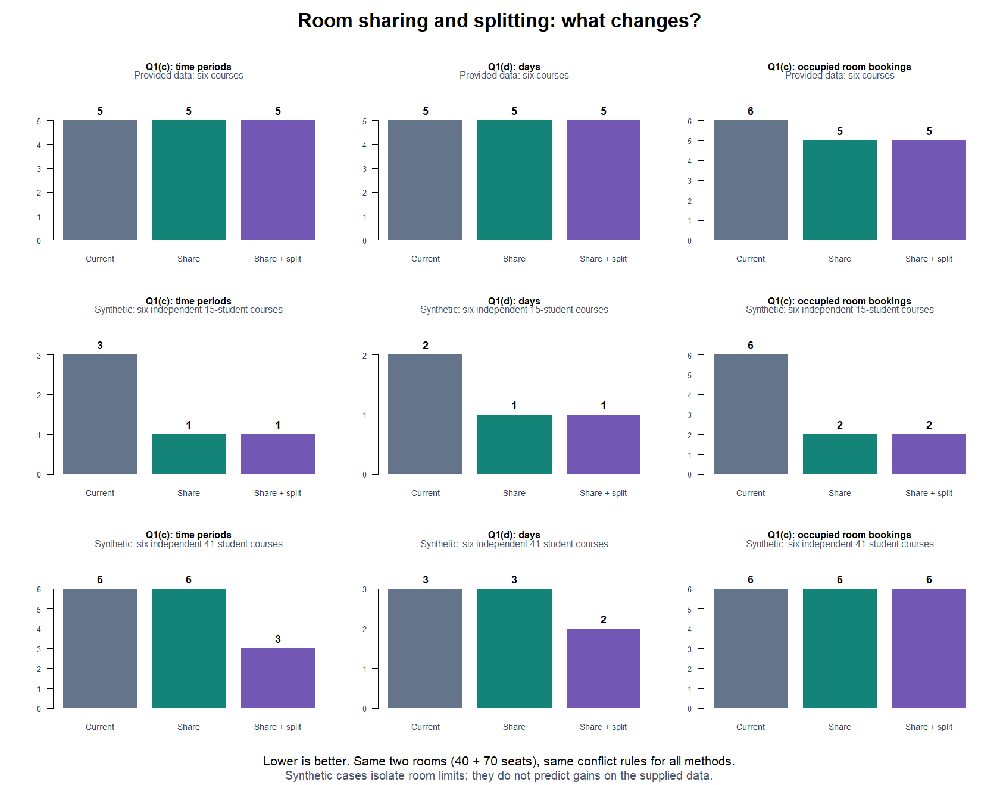
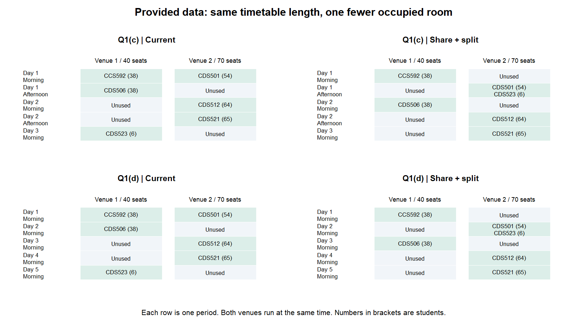
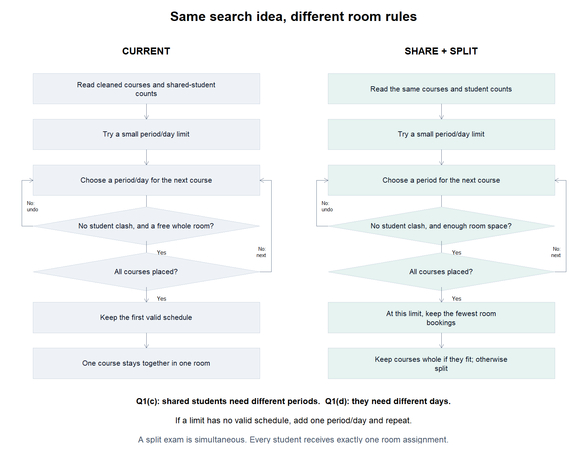

# Q1: sharing rooms and splitting courses

The new model uses room space more freely. Courses with no shared students can share a room, provided their combined numbers fit. A course can also split across the two rooms, with all its students sitting the exam at the same time.

The original model gives each course a whole room. Both models use the same two venues: 40 and 70 seats. For Q1(c), courses with shared students need different periods. For Q1(d), they need different days because morning and afternoon are back-to-back. Consecutive days are allowed.

## Results at a glance



| Dataset | Q1(c): periods, current → new | Q1(d): days, current → new | Room bookings for (c), current → new |
| --- | --- | --- | --- |
| Supplied six courses | 5 → 5 | 5 → 5 | 6 → 5 (17% fewer) |
| Synthetic: six independent courses of 15 students | 3 → 1 (67% fewer) | 2 → 1 (50% fewer) | 6 → 2 (67% fewer) |
| Synthetic: six independent courses of 41 students | 6 → 3 (50% fewer) | 3 → 2 (33% fewer) | 6 → 6 |

A room booking is one occupied venue in one period. Two courses sharing that venue count as one booking. The last column counts bookings across the whole Q1(c) timetable. Q1(d) has the same booking counts in these examples. Percentages are rounded; [comparison.csv](comparison.csv) contains the exact counts.

## What improves on the supplied data?



CDS501 has 54 students and CDS523 has 6. They have no shared students, so all 60 can use Venue 2 together. This removes one occupied room booking in each timetable. Across the timetable, booked seat capacity falls from 330 to 290 for the same 265 registrations; unused seats in occupied rooms fall from 65 to 25. No course needs splitting here.

The timetable cannot become shorter: CCS592, CDS506, CDS512, CDS521 and CDS523 all conflict with one another. Those five courses require at least five different periods for (c), or five different days for (d), regardless of room arrangements. Both models reach those limits.

## Why use synthetic examples?

The examples isolate two room restrictions. They are deliberately favourable cases, not estimates of typical improvements. Every synthetic course has its own students, so these examples have no shared-student conflicts. Both methods receive exactly the same registrations in each comparison.

- **15 students per course:** all 90 registrations fit in one period, with 30 in Venue 1 and 60 in Venue 2. Room sharing alone is enough. The original model needs three periods because it allows only two courses at a time.
- **41 students per course:** each whole course needs Venue 2, so sharing alone still needs six periods. With splitting, a pair of courses totals 82 students and fits across the two rooms. Three such pairs need three periods. Three courses total 123, which exceeds the combined 110 seats, so fewer than three periods cannot work. Six courses also exceed one day's 220 seats, proving at least two days are needed for (d).
- **An oversized course:** a separate case has one 90-student course and five independent 15-student courses. The original and sharing-only models cannot seat the 90-student course. The new model seats all six courses in two periods on one day. This demonstrates added feasibility; there is no percentage improvement over an infeasible timetable.

In the 41-student example, the booking count stays at six: pairs use both rooms. The gain is a shorter timetable and fewer unused seats in occupied rooms (174 → 84). These measurements concern schedules and room usage; they do not measure execution speed or financial savings.

## How the algorithms differ



Both algorithms try a small limit, place a course, and undo a choice when later courses cannot fit. They increase the limit only when no valid schedule exists. For (c) the limit is periods; for (d) it is days.

The original search checks whether a whole room is free for each course. The new search checks whether the courses in a period can fit together in the rooms. At the first feasible period/day limit, it keeps the schedule with the fewest room bookings. It then assigns rooms, keeping each course whole where possible. If that room arrangement needs a split, it divides the course between rooms in the same period and records each student's room.

The new search minimises periods for (c), days for (d), then room bookings. It does not claim the fewest split courses or the fewest unused seats among schedules tied on those goals. Exhaustive search is suitable for these six-course examples; it is not intended for a university-wide timetable.

## Reproduce and check

From the repository root, run:

```sh
Rscript assignment_files/q1_compare_rooms.R
Rscript assignment_files/test_q1_shared_schedule.R
Rscript assignment_files/test_q1_pipeline.R
```

The comparison script regenerates the figures and CSV here. It also exports every input registration list, room timetable and new-model student allocation under `outputs/q1/comparison/`. Synthetic inputs come from `assignment_files/q1_synthetic_cases.R`; the original six input files are unchanged.

The checks cover actual student memberships, combined room capacity, simultaneous splitting, conflicts across rooms, no back-to-back exams, missing or repeated allocations, and courses too large for the rooms. A separate exhaustive enumeration checks the minimum period/day count and room bookings for a mixed case containing both student conflicts and room limits. The supplied-data and synthetic minimum claims above also have direct lower bounds.
